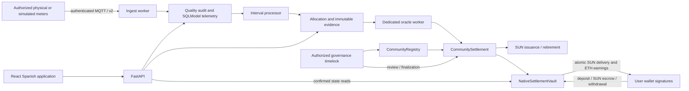

# Solar Energy Market

A community-energy DePIN prototype using **SUN energy credits and native Anvil /
Sepolia test ETH**. Authorized meters report energy, a verifier commits eligible
intervals, the protocol allocates community energy, and a vault atomically delivers
SUN while settling producer earnings. Consumers can retire delivered SUN against
approved consumption.

**1 SUN = 1 eligible verified kWh.** Test ETH is used for deposits, settlement and
gas; it has no real monetary value. Blockchain accounting does not physically route
electricity or automatically change an official electricity bill. Deploying to
Sepolia does not establish legal authorization to commercially exchange electricity.

[Integration and verification](docs/INTEGRATION_REPORT.md) ·
[Security and trust](docs/SECURITY_AND_TRUST.md) ·
[Native protocol](docs/NATIVE_ETH_PROTOCOL.md) ·
[Automated accounting](docs/AUTOMATED_SETTLEMENT.md) ·
[IoT protocol](docs/DEPIN_IOT.md) ·
[Frontend and screenshots](apps/frontend/README.md)

## Architecture and authority



Creating a community produces a proposal, not operational authority. The timelock
approves lifecycle transitions, policies, memberships, nodes and meters. A community
operator manages supported off-chain operations; an oracle submits evidence and
processes approved settlement jobs. Neither can withdraw another user's funds.
Governance is role-based; the application does not fabricate DAO votes.

SUN is issued only from a finalized evidence commitment and an authorized injection
claim. Gross PV generation and net grid export are distinct. Energy deltas use
integer Wh; money uses integer wei. Allocation, ETH settlement and SUN retirement
are separate operations. Retirement burns credits against delivered consumption,
creates no second ETH payment, and cannot be repeated for the same claim. Fungible
SUN does not itself retain a unique per-token origin; provenance resides in the
issuance/evidence ledger.

## Local prerequisites

Use Linux, Python 3.12+, Node 24, Docker with Compose, Git and curl. Install pinned
Foundry, Solidity, Python and npm dependencies:

```bash
./scripts/install_dev.sh
source .venv/bin/activate
```

`DEV_TOOLS` and `DEV_VENV` can select existing tool/virtual-environment directories.
The installer preserves TLS verification and verifies the Solidity compiler checksum.
All runtime secrets are generated or supplied in ignored environment files.

## Exact local startup

From the repository root, with the virtual environment active:

```bash
make setup
make contracts-build
make demo
curl -fsS http://127.0.0.1:8000/ready
curl -fsS http://127.0.0.1:8080/api/v1/openapi.json >/dev/null
```

Open **http://127.0.0.1:8080**. Log in as `govdemo1@solar.local` (producer/operator),
`govdemo2@solar.local` (consumer), or `govadmin@solar.local` (governance fixture).
Read `SEED_PASSWORD` securely from `infrastructure/docker/.env`; it is never printed
or committed. These accounts and credentials are development-only.

`make setup` prepares missing local credentials without replacing existing values,
builds images, waits for PostgreSQL/Redis/MQTT/Anvil, applies reviewed Alembic
migrations in a dedicated one-off service, then starts API, workers and frontend.
It never generates migrations at startup. Anvil state and PostgreSQL are persistent
volumes. API and worker RPC chain IDs must match. Internal Docker hostnames bypass
only the HTTP proxy; external connections retain proxy and CA trust.

`make demo` creates a stable SQLModel community, five users/homes, fifteen simulated
devices, a separate governance fixture, node/meter registrations, an immutable
0.001 ETH/kWh policy and a native deployment. Actual timelock transactions authorize
activation and membership. The local zero-delay timelock is explicitly a demo
convenience; public deployment requires a one-day minimum. The dedicated backend
oracle receives only oracle/settlement authority. The timelock's initial SUN minter
role is revoked after granting mint authority to CommunitySettlement.

Demo wallets are deterministically derived from a private local seed, isolated from
existing linked wallets, funded/unlocked **only on Anvil**, and exported as encrypted
keystores under `.run/demo/wallets` (password: `SEED_PASSWORD`). Never expose these
through the frontend or commit them. Import a keystore securely into a development
wallet if using the actual extension; automated browser tests use an explicit local
wallet transport. Existing unrelated users, wallets and accounting are preserved.
A rerun checks deployment hashes and identities rather than resetting balances,
changing ownership or reactivating suspended memberships.

## Deterministic physical and financial demonstration

Run the finite scenario on reserved demonstration homes 1 and 2:

```bash
make demo-scenario
```

This uses actual MQTT, FastAPI, background workers and Anvil receipts. It publishes
registered, explicitly simulated boundary readings for an ended 15-minute interval,
rejects an invalid credential, and replays valid messages to verify deduplication.
Home A exports 5 kWh; home B imports/consumes 3 kWh. Expected confirmed results:

| Quantity | Result |
| --- | --- |
| Eligible injection / demand | 5 kWh / 3 kWh |
| Allocated / unallocated energy | 3 kWh / 2 kWh |
| Price | 0.001 test ETH/kWh |
| Consumer deposit | 0.01 test ETH |
| Obligation / producer entitlement | 0.003 test ETH / 0.003 test ETH |
| SUN issued / delivered / retired | 5 SUN / 3 SUN / 3 SUN |
| Remaining consumer vault funds | 0.007 test ETH |
| Producer earnings withdrawn | 0.003 test ETH |
| Remaining SUN supply | 2 SUN |

The explicit local fixture authority finalizes the reviewed batch through its
timelock. This command refuses Sepolia; a server must never impersonate public
users or automatically substitute itself for public governance. A resumable journal
records each user transaction hash before confirmation. A completed rerun verifies
existing receipts and projections without issuing a second payment or retirement.
Evidence and results are in `.run/demo/scenario-report.json`.

For continuous registered REALTIME simulation on independent homes 3, 4 and 5:

```bash
make simulate
```

The simulator uses the exact public UUID registry and private credential bindings
produced by bootstrap; QoS1, sequence checkpoints and source labels are preserved.
REALTIME simulation waits for real intervals and the two-minute late-arrival margin.
Offline/accelerated simulation remains explicitly distinguishable and is withheld
from live settlement. The generated home catalogue reserves homes 1/2 for the finite fixture and uses
separate home 3/4/5 meter identities for continuous simulation. Do not override that
separation or mix counter/sequence streams on the same device.

## Meter registration outside the local fixture

1. Register/login and verify wallet ownership using the signed challenge API.
2. Propose a community; governance reviews, approves policy/price and activates it.
3. Apply for membership and synchronize confirmed registry status.
4. Create a home; an operator proposes its node.
5. Governance registers the node owner and authorizes the public meter UUID.
6. The operator records the internal device UUID and a fresh 32+ character telemetry
   credential through `/communities/nodes/{node_id}/meters`.
7. Publish v2 packets on `solar/{community}/{node}/{device}/telemetry`. Signatures,
   units, timestamp, sequence, device type, source and physical plausibility are
   checked. Raw credentials are not stored in telemetry or quality evidence.

Use authenticated per-device broker ACLs and TLS across untrusted networks. The
anonymous development broker binds only to loopback. Provision grants with
`scripts/provision_mqtt_acl.py` and the secure MQTT overlays documented in
[DEPIN_IOT.md](docs/DEPIN_IOT.md).

## Sepolia deployment

See [the deployment runbook](docs/SEPOLIA_DEPLOYMENT.md). No Sepolia RPC/deployer
credential is bundled. Test ETH must come from an externally funded account or an
available external faucet; unrestricted faucet access is never assumed.

The canonical entry point is `scripts/deploy.sh COMMUNITY_UUID --network sepolia`.
It performs chain, funding, explicit authority and artifact checks without sending.
Adding `--broadcast` explicitly deploys and waits for three confirmations per
contract. Public journals preserve pending hashes for recovery. Deployment does
not activate a community: governance must review and execute the separate setup
plan, approve the community, authorize nodes/meters and finalize evidence.

Only confirmed deployment addresses belong in backend/frontend configuration.
Frontend Vite variables are public; private keys and authenticated RPC credentials
must never be placed in `VITE_*` settings. MetaMask connection is separate from
application login and wallet ownership verification. Switch to chain 11155111,
fund gas/deposits with test ETH, and review every contract/value before signing.

## Tests and migrations

```bash
make test                    # Foundry, real backend integration, IoT, frontend
make test-backend             # fresh disposable PostgreSQL; MQTT/Redis/Anvil test ports
make test-iot                 # isolated broker and gRPC gateway; no development broker dependency
make test-frontend            # strict types, lint, unit/component/hook/wallet tests, build
make migrate                 # existing reviewed Alembic revisions only
```

For browser integration, keep the local stack running and start Vite in another
terminal, then create a fresh stateful browser fixture:

```bash
cd apps/frontend
npm run dev -- --host 127.0.0.1
# Another terminal in apps/frontend:
npm run test:e2e:all
```

The native browser suite mutates test contracts (retirement/membership); its command
creates a fresh fixture for every complete run. Actual API, signed ownership proofs,
Anvil calls and receipt/index confirmation are used; production screens contain no
mock success data. The actual extension and live Sepolia need separate verification.

```bash
make ps
make logs
make down                    # preserves volumes
make up
python scripts/sync_abis.py  # checks compiled artifacts against backend/frontend ABIs
```

## Operational checks and troubleshooting

- `/health` checks API/database liveness; frontend `/health` checks static serving.
  `/ready` on port 8000 additionally checks Redis, matching RPC chain and fresh
  worker/subscriber heartbeats. Missing/degraded workers cannot report ready.
- Configuración shows service readiness. Authorized community operators can query
  `/api/v1/communities/{id}/operations/status` for index lag, failed jobs,
  reconciliation alerts and telemetry quality counts. Device health reports source,
  freshness, authorization, assessments and recent intervals.
- Submitted is not confirmed. Wait for receipt depth **and** event indexing. If a
  transaction is delayed/replaced or the indexer lags, use Transacciones and the
  operator's reconciliation controls. Do not repeat a payment on an unknown outcome.
- If bootstrap refuses a wallet, identity, credential or deployment mismatch, review
  it; existing ownership is not overwritten. Preserve PostgreSQL and Anvil state
  together. A deliberate chain reset requires a fresh demo database/journal or an
  explicit accounting migration, not silent reuse of old confirmed records.
- With a cloud proxy, retain proxy/TLS settings and mount the combined CA bundle.
  `CLOUD_CA_BUNDLE` can select it. Both `NO_PROXY` and `no_proxy` include only internal
  service names and loopback. An RPC 403 or chain mismatch is a connectivity/config
  failure, never proof of a confirmed settlement.
- MQTT access failures: check provisioned identity, exact topic ACL, credential,
  certificate trust, last authenticated reading and the quality audit. A fresh
  arrival timestamp does not make an old measurement current.

Legacy payment-token contracts and tests remain for historical compatibility;
legacy workers are disabled by default (`LEGACY_SETTLEMENT_ENABLED=false`). Old
USDx instructions are superseded by this native protocol. Native ETH P2P trading,
public community discovery, profile editing, full participant-visible evidence and
complete SUN event histories remain outside the current API. This is a technical
prototype, not a production security audit or a regulatory approval.
