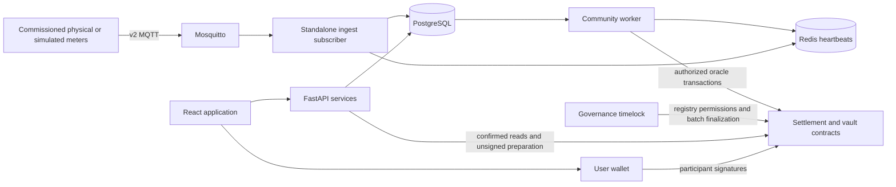
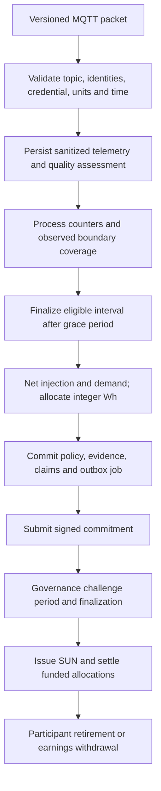
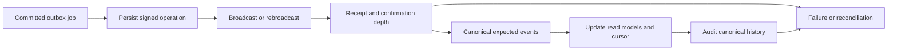

# Architecture

The canonical backend package is [src](../apps/backend/src), with entry point
`src.main:app`. SQLModel classes and reviewed Alembic revisions define persistence.
The active governed protocol uses SUN and native test ETH; historical payment-token
code remains separately identifiable.

## Components and trust boundaries

| Layer | Responsibility and boundary |
| --- | --- |
| Frontend | Spanish UI, authenticated HTTP, community/home selection, EIP-1193 wallet connection and exact transaction review; no private keys |
| FastAPI routers | Request validation and authenticated entry points; version prefix `/api/v1` |
| Domain services | Ownership, community/member/operator authorization, energy policy, batch construction and transaction preparation |
| Repositories and SQLModel | Shared async SQLAlchemy sessions, locks and queries; several services query directly, so separation is a convention rather than universal enforcement |
| MQTT subscriber | Envelope/topic/source/credential validation, deduplication, safe audit, raw and typed reading persistence; never mints or pays |
| Community worker | Counter processing, interval finalization, native batch discovery, durable signed outbox work, indexing and canonical-history audit |
| PostgreSQL | Identity, commissioned device relationships, telemetry, immutable policy/evidence snapshots, outbox and chain read models |
| Redis | JWT revocation, service heartbeats and optional Celery mail broker; not the authoritative financial ledger |
| EVM contracts | Governed authority, commitments, bounded issuance, funded SUN delivery, native ETH liabilities and retirement |

The application authenticates with bcrypt passwords and bearer JWTs; wallet linking
separately verifies a single-use EIP-191 challenge. Home reads enforce ownership in
the current services; there is no `home_members` table. Community membership and
operator access are separate from application roles and registry governance roles.
See [API](api.md) and [security](../SECURITY.md).

## Data and accounting flow

Raw evidence, sensor readings and allocation calculations stay off-chain. On-chain
Merkle commitments bind quantities and identities; contracts cannot independently
prove the physical truth of those inputs. Physical commissioning, credential
security, oracle review and governance remain trusted responsibilities.
[IoT](iot.md) defines quality gates; [settlement](community-settlement.md) defines
eligibility and financial invariants.

The simulator's coordinated household model supplies PV, load, import/export and
battery channels from one conserved state. The normal registered path publishes
v2 directly to MQTT. The optional protobuf/gRPC gateway is a v1 diagnostic path,
not the canonical governed simulator transport.

## Transactions and recovery

A business change and its outbox job commit together. The service signs and commits
raw transaction bytes before broadcasting. PostgreSQL advisory locks coordinate
shared oracle nonces by chain ID, genesis hash and sender. Retries reuse the signed
operation; explicit fee replacement preserves nonce/value/calldata and retains
attempt history.

Confirmed state requires successful receipts, canonical hashes, configured depth
and event indexing. Orphaned events remain retained; affected records enter review
rather than inventing economic reversals. Missing deployment code quarantines
native projections. Unknown genesis signatures cannot be rebroadcast automatically.
The browser journal is a recovery aid and has no authority to change balances.

## Architectural decisions retained from the audit

- **One schema:** SQLModel metadata plus Alembic, with model registration in every
  process. Historical SQL snapshots are not an alternate installation path.
- **Evidence before entitlement:** persist validated telemetry and source references;
  an interval or pending credit is not proof of token issuance or payment.
- **Conservative missing data:** exact boundary coverage and plausible counters;
  resets/gaps establish baselines instead of estimated credits.
- **Contract custody:** native deposits and producer SUN escrow back reservations;
  users sign exits, and settlement is atomic. Old off-chain unreserved matching is
  not the active financial mechanism.
- **Separate governance:** community appointment does not confer registrar/oracle
  permissions. Batch finalization remains an authorized governance action.
- **Relational telemetry:** the Compose image includes TimescaleDB, but current
  Alembic migrations do not create hypertables or retention policies. Global
  sequence uniqueness and referenced UUID keys require deliberate time-aware key
  design before hypertable conversion. No retention duration is assumed.

These replace earlier recommendations that were superseded by implemented escrow,
device authentication, native settlement and indexing. Remaining product and
operational limits are listed in the [README](../README.md#status-and-limitations).
