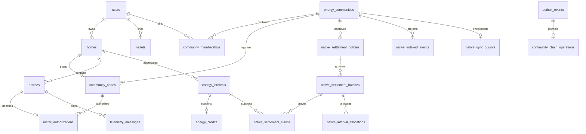

# Database

The canonical schema is [SQLModel metadata](../apps/backend/src/core/models.py)
registered from `apps/backend/src/modules/*/models.py`, with reviewed revisions in
[Alembic](../apps/backend/migrations/versions). The initial revision is
`6da8fac7d51a`; the current head is `20261111_chain_identity`. The prototype uses
PostgreSQL 16 through a TimescaleDB image. Current Alembic revisions create neither
Timescale hypertables nor automated retention policies; ordinary PostgreSQL is
also exercised by integration tests.

`database/schema_v2.sql`, `database/migrations/001_integrity_and_timescale.sql` and
the former ER diagram describe a historical schema. They are retained non-Markdown
artifacts, not migrations to apply to the current database. Do not install them
alongside Alembic. The current relationships below replace that old diagram.

## Main domains and actual table names

Most business entities use UUID `id` primary keys. The user key is **`users.uid`**;
community deployments/cursors use `community_id`, meter authorization uses
`device_id`, and energy power snapshots use `(device_id, channel)`.

| Domain and tables | Important fields and relationships |
| --- | --- |
| `users`, `wallets`, `wallet_nonces` | Bcrypt `password_hash`, application `role`; wallets reference `users.uid`; unique wallet address and expiring/consumed ownership nonce |
| `homes` | `owner_id -> users.uid`, location/timezone, installed capacity and battery flag; no `home_members` table |
| `energy_communities`, `community_memberships` | Boundary/policy commitments, lifecycle, simulation consent; membership joins users to communities |
| `community_nodes`, `meter_authorizations` | Home-to-community physical node; a device is bound to a node with active flag and credential digest |
| `devices`, `device_credentials` | Internal `id`, distinct public wire `device_id`, home, type/source, MQTT identity, status, hardware counter modulus; separate device credential records are not a substitute for meter authorization |
| `telemetry_messages`, `telemetry_assessments` | Sanitized payload, measured/reception time, sequence, message identity/source/mode; safe quality evidence, digest and occurrence count |
| `smart_meter`, `inverter`, `battery`, `weather` | Typed readings reference `telemetry_messages.id`; these are the actual names, not `*_readings` |
| `device_counter_snapshots`, `energy_power_snapshots` | Processed counter baselines and per-channel power integration state |
| `energy_intervals`, `energy_credits`, `credit_movements` | Integer Wh, time bounds, calculation version, quality and source-linked evidence; credit references one interval and owner |
| `native_settlement_policies` | Immutable community/policy-hash snapshot, price, rules and governance reference |
| `native_settlement_batches` | Community/policy FK, unique interval, chain batch ID, Merkle root, evidence, totals and status |
| `native_settlement_claims` | Batch/user/node/internal meter/interval FKs, optional unique credit FK, on-chain claim ID, Wh and saved proof |
| `native_interval_allocations` | Batch, producer/consumer users and nodes, injection/demand intervals, price-derived `due_wei`, proof and funding/delivery state |
| `community_native_deployments` | Governed per-community chain, SUN, settlement and vault bindings |
| `outbox_events`, `community_chain_operations` | Durable job lease/attempt/error and signed oracle bytes/hash/nonce/chain genesis; operation references unique outbox job |
| `native_indexed_events`, `native_sync_cursors`, `native_wallet_transactions` | Canonical chain event/cursor projections and participant-submitted transaction references |
| `community_energy_ledger`, `audit_events` | Retained accounting/audit evidence; community ledger rejects UPDATE/DELETE through a PostgreSQL trigger |
| `community_chain_deployments`, `community_chain_sync_state`, `community_energy_allocations`, `compensation_requests`, `settlement_obligations` | Historical ERC-20 protocol deployments, reservations, retirements and simulated payment evidence; separate from native records |
| `orders`, `trades`, `redemptions`, `blockchain_transactions`, `blockchain_events` | Earlier marketplace/redemption and generic transaction history; not the active native settlement ledger |

There is no current `energy_interval_sources`, `token_issuances`,
`refresh_tokens` or `redemption_settlements` table. Provenance is retained through
the actual telemetry/interval/batch evidence fields and claim relationships.

## Current relationship overview



The diagram is selective: batch claims and allocations also link users, nodes,
devices and intervals, as listed above. A local projection is not independent proof
of a canonical chain transaction.

## Integrity and numerical representation

Energy is integer Wh. Native prices/obligations use `NUMERIC(78,0)`; API amounts
are decimal integer strings and EVM quantities are uint256. Earlier token amounts
use decimal SQL columns and must retain their original asset/decimal semantics.
Timestamps used for interval and event processing are timezone-aware.

Important uniqueness and checks include:

- User email/username and case-insensitive email index; globally unique wallet address.
- Telemetry `(device_id, sequence_number)` and non-null per-device message identity.
- One energy interval per home/start/end and one credit per interval.
- One native batch per community/start/end; immutable policy snapshot per community/hash.
- One claim per batch/kind/node and unique chain claim/credit references.
- One producer-node/consumer-node pair per batch and unique chain allocation identity.
- One signed operation per outbox job; nonce uniqueness across
  `(chain_id, chain_genesis, sender, nonce)`.
- Native indexed-event uniqueness across chain/transaction/log/block hash; orphaned
  versions remain available with `canonical=false`.

Indexes target home/time, owner/status, batch/participant, pending outbox availability,
processing leases and chain lookup. Locks and constraints work together; an
application precheck alone is insufficient for concurrent calculations or signing.
See the model/migration definitions for the complete index and constraint set.

SQL identity/device configuration and immutable evidence are authoritative off-chain
records. Native balances, delivery and retirement are chain-authoritative;
`native_*` projections and tracked transaction statuses must be reconciled to
confirmed receipts/events. Database administrators still control the database;
the append-only trigger is not a claim of tamper-proof storage.

## Migration and recovery workflow

```bash
make migrate
```

The dedicated service runs reviewed `alembic upgrade head`. To author a change,
edit canonical models, generate a revision against an explicitly configured
**disposable development database**, review its SQL/data transformations, and test
fresh upgrades plus upgrades with existing records. Run Alembic from `apps/backend`;
[env.py](../apps/backend/migrations/env.py) imports metadata and reads `DATABASE_URL`.
Never generate revisions automatically during deployment.

The genesis migration preserves historical operations with an empty/unknown
`chain_genesis`; those signatures require explicit reconciliation. A downgrade that
would collide across chain origins fails rather than deleting history. Financial
migrations need reviewed archival/reversal strategies, not blind table drops.
Preserve PostgreSQL and EVM history together. Resetting Anvil independently leaves
invalid deployment addresses and stale projections; the worker quarantines these
rather than inventing new payments. See [blockchain recovery](blockchain.md#reconciliation).
